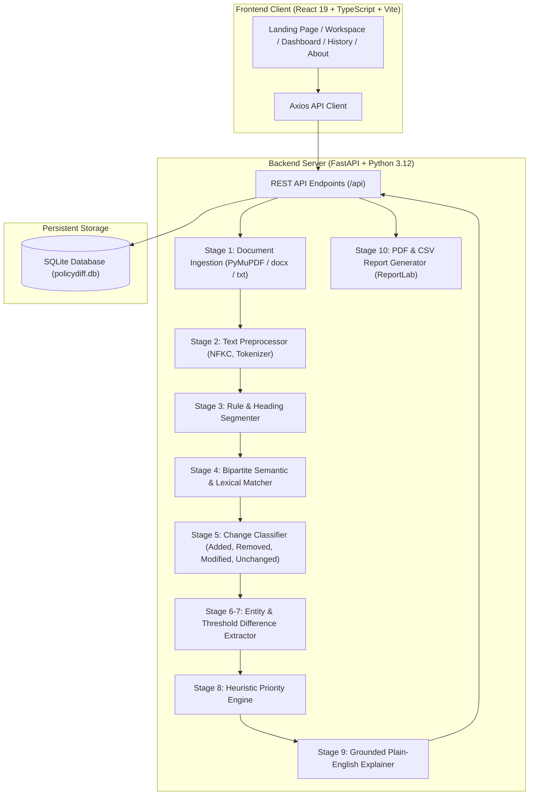

# PolicyDiff System Architecture & NLP Technical Specification

**PolicyDiff — Semantic Policy Change Detector** is an explainable natural language processing and document intelligence platform designed to discover nuanced, regulatory, and threshold differences across revised academic policies.

---

## 1. High-Level System Architecture

---

## 2. The 10-Stage Core NLP Pipeline

### Stage 1: Document Ingestion
- Ingests PDF (`PyMuPDF`), DOCX (`python-docx`), and raw TXT.
- Preserves pagination, structural line breaks, and page references.
- **Scanned PDF Guard**: Checks character yield across pages. If text length $< 30$ characters on multi-page PDFs, flags `ScannedPdfError` notifying the user that an OCR layer is required.

### Stage 2: Text Preprocessing & Tokenization
- Normalizes unicode using `unicodedata.normalize('NFKC')`.
- Protects legal/academic abbreviations (`dr.`, `prof.`, `sec.`, `art.`, `e.g.`, `i.e.`, `no.`, `dept.`).
- Protects decimal numbers (e.g. `75.5%`, `3.8 CGPA`) from sentence-boundary splits.
- Retains casing and exact character spans so displayed excerpts match the authoritative source text.

### Stage 3: Clause & Section Segmentation
- Detects section headings (`Section 1: ...`, `ARTICLE IV`, `All-Caps Headings`, headings terminating in colons).
- Dissects numbered rules (`1.1`, `a)`, `(i)`, `Rule 2:`) and bullet points into independent `RuleUnit` instances with section context and page tags.

### Stage 4: Cross-Version Bipartite Alignment
PolicyDiff matches rules cross-version rather than comparing naive line indices.

#### Dual-Engine Embedding:
1. **Dense Transformer Embeddings**: Uses `sentence-transformers` (`all-MiniLM-L6-v2`) generating 384-dimensional dense vectors with cosine similarity.
2. **Lightweight TF-IDF & Character N-Gram Fallback**: Character n-grams (`3-5`) + word n-grams (`1-3`) + RapidFuzz `token_set_ratio` to guarantee full functionality offline.

#### Alignment Formulation:
$$\text{Score}(u_{\text{old}}, v_{\text{new}}) = 0.60 \cdot \text{Sim}_{\text{semantic}}(u, v) + 0.40 \cdot \text{Sim}_{\text{lexical}}(u, v) + \delta_{\text{section}}$$

Where:
- $\text{Sim}_{\text{semantic}}$ is cosine similarity between rule embeddings.
- $\text{Sim}_{\text{lexical}}$ is token-set ratio between the rule texts.
- $\delta_{\text{section}} = +0.06$ if both rules share the identical section heading.

### Stage 5: Change Classification
- **ADDED**: Rule appears in the updated document with no counterpart exceeding the matching threshold ($\tau = 0.48$).
- **REMOVED**: Previous rule with no counterpart in the updated document.
- **MODIFIED**: Aligned rule pair with entity discrepancy, obligation shift, or semantic revision ($\text{Sim} < 0.94$).
- **UNCHANGED**: Aligned rule pair with zero entity discrepancies and high semantic/lexical similarity ($\text{Sim} \ge 0.60$ and lexical overlap $\ge 0.68$).

### Stage 6 & 7: Entity and Modality Difference Extraction
Extracts and compares:
- **Numerical percentages**: e.g., $75\% \to 80\%$.
- **Dates & Deadlines**: e.g., `15 July 2025` $\to$ `30 July 2026`.
- **Financial values**: e.g., $\$100 \to \$150$.
- **Quantitative thresholds**: e.g., `2 attempts` $\to$ `3 attempts`.
- **Modality & Obligations**: Discretionary (`may`, `can`) vs Mandatory (`must`, `shall`, `required`).
- **Prohibitions & Negations**: Flipped conduct states (`permitted` $\to$ `strictly prohibited`).
- **Target Student Cohort**: `all students` $\to$ `final-year undergraduate students`.

### Stage 8: Priority Assessment Heuristics
Transparent, deterministic heuristics:
- **Critical**: Debarment, examination disqualification, disciplinary suspension, or newly introduced strict prohibitions.
- **High**: Attendance percentage threshold increases, major deadline changes, fee increases, or modality escalation (`may` $\to$ `must`).
- **Medium**: Quantitative attempt adjustments, minor procedural alterations.
- **Low**: Unchanged rules or minor clerical stylistic refinements.

### Stage 9: Grounded Plain-English Explanations
Explanations are deterministically assembled using structured difference evidence. No ungrounded LLM hallucinations—every sentence refers strictly to the detected numbers, dates, and obligations.

### Stage 10: Traceability and Export
- Records are persisted in SQLite.
- Interactive side-by-side card explorer on the web interface.
- One-click export to formal executive PDF reports (via ReportLab) and raw structured CSV data.
